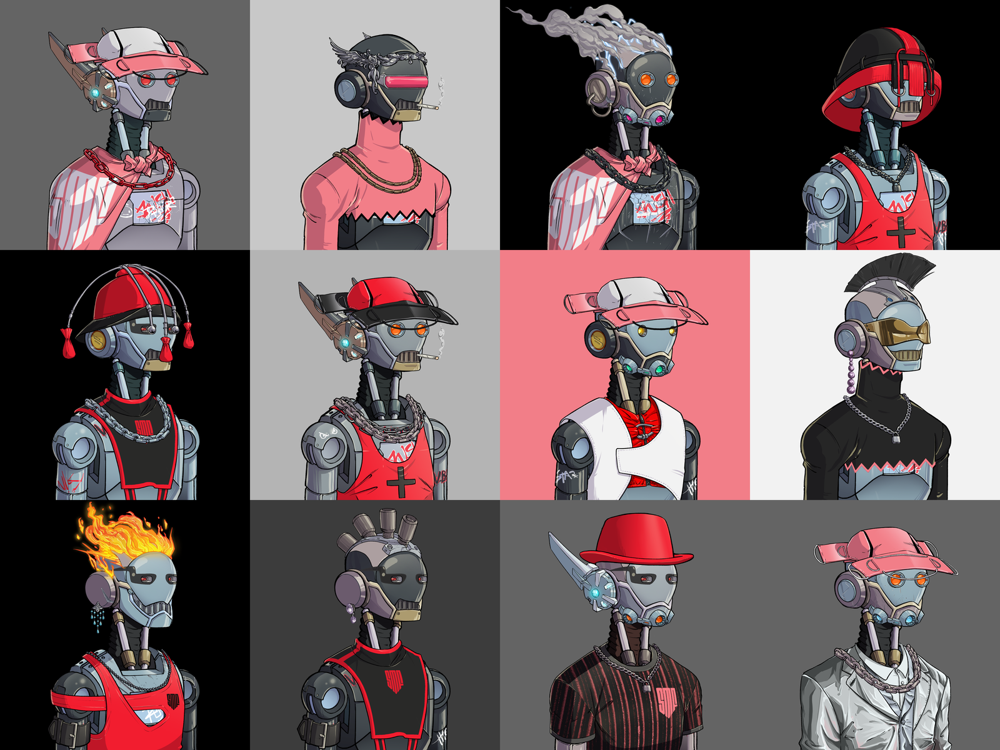

# sociedadeMecanicaGenerator

The avatar generator of [sociedade mecânica de futebol](https://a-s-k.studio/apex-solar-kiss/sociedade) (2022): the [HashLips Art Engine](https://github.com/HashLips/hashlips_art_engine), configured by ASK to assemble the project's robot avatars from its commissioned component library. The banner shows twelve outputs from a test compile on 2022-09-14. Recovered into this fork in 2026 as historical source.

> **Historical source, not a working demo.** The component-art layers are not included. The recovered configuration also expects five layer families that are not in the working copy this recovery used, so this edition cannot reproduce the original run. The avatar collection never launched.

**Historical outputs >>** see the sociedade mecânica de futebol project presentation on [A-S-K.studio](https://a-s-k.studio/apex-solar-kiss/sociedade).

**Runnable geometric example >>** [shapesASK](https://github.com/apexSolarKiss/sociedadeMecanicaGenerator/tree/shapesASK)

## What is here

Branch `sociedade-mecanica` is the HashLips Art Engine at tag [`v1.1.2_patch_v1`](https://github.com/HashLips/hashlips_art_engine/tree/v1.1.2_patch_v1), plus ASK's commits:

1. **The 2022 changes**, imported from the studio's working copy, which had no Git history:
   - `src/config.js` holds the layer grammar described below.
   - `src/main.js` writes `copyright: "bunda labs"` into generated metadata where HashLips writes `compiler: "HashLips Art Engine"`. This is the 2022 setting, kept as found. It does not license the generated art or establish who owns it now.
   - `package.json` adds `yarn`. The two lockfiles are from the same working copy.
   - `smf/nomes.js` is a 2022 helper that renamed the numbered images of the `nomes` layer to Swedish given names. It renames files in a `nomes` folder beside the script, which here means `smf/nomes/`, not `layers/nomes/`. It is kept for reading and was not tested.
2. **This README, its banner and [`NOTICE`](NOTICE).**
3. **The layer folders, their inventories and a preflight check**, added in 2026: see [The layers](#the-layers).

Two things differ from the 2022 files:

- `baseUri` is set back to the upstream placeholder, `ipfs://NewUriToReplace`.
- In `src/config.js`, the folder names `pichações`, `chápeu A` and `chápeu B` use precomposed accents (Unicode NFC), where the 2022 file used decomposed ones (NFD). The folders in `layers/` are tracked in NFC, because Git on macOS lists decomposed folder names as untracked copies of themselves, and the configuration was normalized to match them, so each name resolves on macOS and Linux alike. The visible spelling, including the 2022 `chápeu`, is unchanged, and the decomposed original stays in this branch's history.

HashLips' own demo files from upstream, its `layers/` folders, `logo.png` and `banner.png`, were removed in 2026. They remain in this branch's history. Branch `main` is HashLips' upstream branch, as forked.

## How the configuration worked

The engine knows nothing about robots. `src/config.js` tells it what to draw.

- **Layers.** Each avatar stacks one image per layer entry, bottom first:
  - `nomes` (names) and `fundo` (background). `nomes` draws nothing visible. Its 200 files are one image under 200 given names, so the layer gives each avatar a randomly assigned name, carried in the metadata as a trait;
  - `chassi` (chassis);
  - `pichações` (graffiti), drawn eight times;
  - `danos` (damage);
  - `antena` (antenna), `camisa` (shirt), `boca` (mouth) and `olhos` (eyes);
  - `chápeu` (hat) and `joias` (jewelry).

  Each entry draws from a folder in `layers/`. The engine picks one image per entry, weighted by the number after `#` in its file name (`element#weight.png`), or 1 when the file name carries no numeric weight.
- **Four configurations.** The 400 avatars, at 2160 × 2160, split across four layer configurations:

| Configuration | Avatars | Folders that change |
|---|---|---|
| small hats | 285 | `antena A`, `boca A`, `chápeu A` |
| big hats | 95 | `antena B`, `boca B`, `chápeu B` |
| fire + small hats | 15 | the A folders; `camisa` is dropped and `camisa queimando` (burning shirt) is drawn on top |
| fire + big hats | 5 | the B folders; `camisa` is dropped and `superaquecimento` (overheating) is drawn on top |

  The hat families are weighted 3:1, and the fire configurations get 5% of the collection. The four groups are shuffled together in the final numbering.
- **Uniqueness.** `nomes` and `fundo` are left out of the DNA the engine uses to keep avatars unique. So two avatars that differ only in name or background count as duplicates.

Swapping the images inside the folders changes what the generator makes. Changing which folders exist, their order or the configuration split means editing `src/config.js`.

## The layers

`layers/` holds the 16 family folders that `src/config.js` names, in its spelling. Each is empty apart from a hidden `.gitkeep`, which the engine skips. The production art is not included. Git ignores everything else in these folders, so restored art stays local.

An asset's weight lives in its file name, so empty folders cannot keep it. [`smf/inventory/`](smf/inventory/) records, without the images, the name, weight and SHA-256 checksum of every file the engine reads in the families it covers, in three files that keep their sources apart:

- [`working-copy.json`](smf/inventory/working-copy.json): the 11 families in the 2022 working copy this recovery used, 406 files.
- [`compile-ask-supplement.json`](smf/inventory/compile-ask-supplement.json): `antena B`, `boca B` and `chápeu B`, from six 2022 compile folders, a different source set. The folders hold different versions of these families, and none is established as the version the final configuration used.
- [`unresolved.json`](smf/inventory/unresolved.json): the five families missing from the working copy. `camisa queimando` and `superaquecimento` were not found anywhere searched.

Together, the inventories are not the complete final configuration.

`npm run check:layers` checks `layers/` against `src/config.js` and compares any restored files with the inventories. It changes nothing and does not run the generator. `npm run check:layers -- --layers <folder>` checks a restore source before its files are copied in.

## Before running anything

- Run `npm run check:layers`. It exits 0 only when every family is present and matches the working-copy inventory, which cannot happen until the five missing families are found. A clone without the production art exits 2.
- Output goes to `build/` at the root of the clone. Git ignores `build/`, and `buildSetup()` deletes it recursively at the start of every run, so copy a finished run to a folder outside the repository before running again.
- Generation uses unseeded randomness and timestamps, so a run cannot be reproduced.
- Dependencies are the 2022 versions. They have not been updated or audited.

## Upstream documentation

This repository is a fork of the [HashLips Art Engine](https://github.com/HashLips/hashlips_art_engine). Branch `sociedade-mecanica` is based on its tag [`v1.1.2_patch_v1`](https://github.com/HashLips/hashlips_art_engine/tree/v1.1.2_patch_v1). For the engine's installation, options and utilities, see the [upstream README at that tag](https://github.com/HashLips/hashlips_art_engine/blob/v1.1.2_patch_v1/README.md). This README documents only the SMF recovery.

## Credits

- engine >> [HashLips Art Engine](https://github.com/HashLips/hashlips_art_engine)
- avatar creative direction >> Alex Limpo de Abreu
- CTO + generative avatar system development >> ASK
- avatar illustration >> P R Soliver
- avatar styling >> Antônio Frajado

## License

MIT, as in [`LICENSE`](LICENSE) (Copyright (c) 2021 HashLips). ASK's code and documentation changes on this branch, other than the avatar banner, are offered under the same license.

No SMF production layers are included. The documentation banner and social preview are excluded from the MIT License and carry no reuse grant. See [`NOTICE`](NOTICE).
