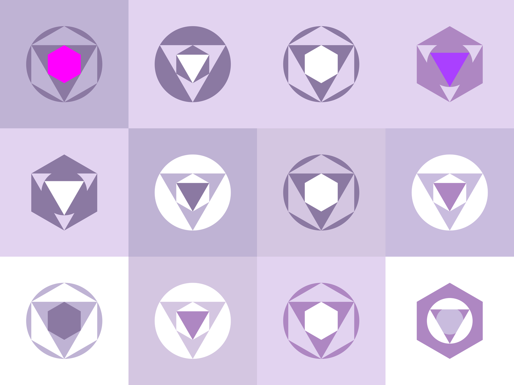

# sociedadeMecanicaGenerator // shapesASK example



This branch runs the [HashLips Art Engine](https://github.com/HashLips/hashlips_art_engine) on **shapesASK**, ASK's compositions of circles, hexagons and triangles. It shows the recovered engine assembling an independent layer set. The historical sociedade mecânica de futebol recovery is branch [`sociedade-mecanica`](https://github.com/apexSolarKiss/sociedadeMecanicaGenerator/tree/sociedade-mecanica), whose README documents the 2022 configuration.

## Run the example

```bash
npm ci
npm run generate -- --count 32 --output /path/to/new-run-folder
```

`npm run generate:export` is the same command. `.nvmrc` names the tested Node version. [`examples/shapesASK/README.md`](examples/shapesASK/README.md) covers the options, the color rules and what a run writes.

The source layers are the example's four editable SVG masters in [`examples/shapesASK/source/masters/`](examples/shapesASK/source/masters/), one group per layer. Each run prepares its PNG layers from them, so the branch has no `layers/` folder.

## What this branch changes

It starts from `sociedade-mecanica` before that branch's avatar banner, and changes:

- **`examples/shapesASK/`:** the example. That covers the editable masters and color rules, the recipe planner, layer preparation, validation and export.
- **`src/main.js`:** generated metadata carries HashLips' upstream `compiler: "HashLips Art Engine"` field again, in place of the 2022 `copyright: "bunda labs"` line. The file is now identical to HashLips' tag `v1.1.2_patch_v1`.
- **Dependencies:**
  - `canvas` is pinned at 3.2.3, replacing `^2.8.0`, which publishes no prebuilt binary for current Node on Apple silicon;
  - `.nvmrc` is `v22.12.0`;
  - the `yarn` dependency and `yarn.lock` are removed, so npm alone installs;
  - `package-lock.json` is regenerated.
- **`package.json`:** `generate` runs the example, as the added `generate:export` does, and the `license` field names both licenses.
- **Removed:** HashLips' demo `layers/`, `logo.png` and `banner.png`, which the example never used. They remain in this branch's history and on branch `main`.
- **`NOTICE`:** maps each file to its license.
- **`docs/assets/shapesASK-banner.png`:** this README's banner, the first twelve images of a 32-image run of the example, four across and three down.

**Unchanged:**

- `src/config.js` still holds the 2022 configuration. The example does not use it. `npm run build` still runs the engine on it directly and needs the original layers, which are not included.
- `smf/`, `utils/` and `LICENSE`.

## Credits

- engine >> [HashLips Art Engine](https://github.com/HashLips/hashlips_art_engine)
- shapesASK >> ASK

## License

The shapesASK example is open source under the Apache License, Version 2.0, in [`examples/shapesASK/LICENSE`](examples/shapesASK/LICENSE): its code, rules and configuration, editable masters and documentation, this README's banner, and the images and other files it generates. The HashLips Art Engine and every other file on this branch stay under the MIT License in [`LICENSE`](LICENSE) (Copyright (c) 2021 HashLips). [`NOTICE`](NOTICE) maps each file to its license.
